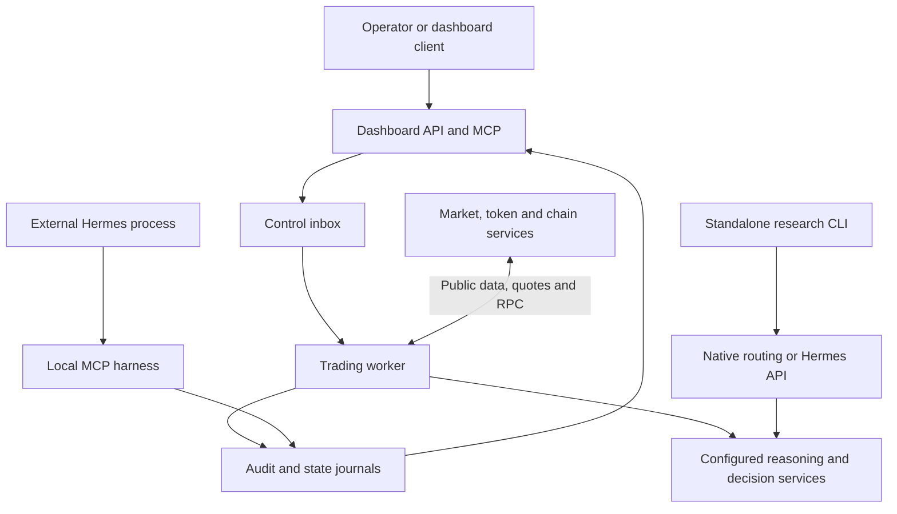
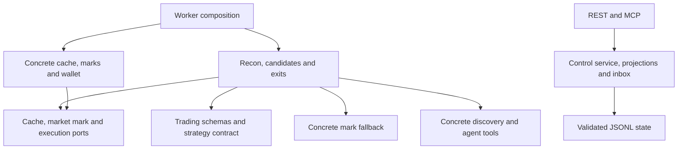
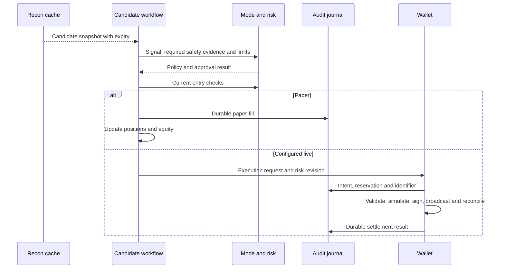

# Architecture audit

## Scope and sources

The audited checkout was clean on `strategy/early-momentum-reversal` at `6024484b415169e0ce83f52edf939c3794727139`. Its file tree matched GitHub `main` at merge commit `0cbae62b390e0fd430efe4f0ee995334c50948b1`. This document describes the baseline implementation. The [refactoring report](refactoring-report.md) records the final implementation and verification. Architecture and integration ADRs provide intent. Runtime entry points, imports and tests establish implementation.

## System context and deployment

**Verified.** The repository contains one private ESM package. TypeScript on Node.js is the application runtime, Shell supports deployment, and JSON, JSONL and Markdown hold configuration, journal records and contracts. Hono and its Node adapter serve the dashboard, the MCP SDK serves stdio and HTTP, and Zod validates contracts. JOSE supports the dashboard JWT mode. Viem, Solana Web3.js and Scure/Noble packages implement chain handling. The key source module also defines AWS KMS support. Dependencies and versions are in [package.json](../package.json) and [the lockfile](../package-lock.json).

| Entrypoint | Runtime role and evidence |
| --- | --- |
| [`src/index.ts`](../src/index.ts#L97) | Composes worker dependencies, restores state from the audit journal, acquires an exclusive live journal lock, and starts Recon, candidate processing and position watching. A configured native Bitcoin wallet uses the separate native intent path in the same worker. |
| [`src/dashboard-api/server.ts`](../src/dashboard-api/server.ts) | Loads legacy or JWT auth settings and constructs Hono routes and the Node listener. |
| [`src/mcp/server.ts`](../src/mcp/server.ts) | Creates the shared control service and chooses stdio or HTTP. The restricted harness profile requires stdio. |
| [`src/agent-runtime/cli.ts`](../src/agent-runtime/cli.ts), [`src/learning/`](../src/learning/) | Independent research and offline evaluation entry points. Research chooses the configured runtime. Evaluation uses recorded inputs. |
| [`health.ts`](../health.ts), [Dockerfile](../deploy/docker/Dockerfile), [Compose](../deploy/docker/docker-compose.yml) | One compiled image with worker, dashboard and MCP service commands. Dashboard and MCP receive read-only journal mounts and writable control mounts in Compose. Worker secrets and dashboard tokens use separate mounts. An [isolated research profile](../deploy/docker/docker-compose.research.yml) is optional. |
| [CI](../.github/workflows/ci.yml), [deployment workflow](../.github/workflows/deploy.yml), [runbook](../deploy/README.md) | Hosted CI checks precede image publication. Production deployment is separately gated by a GitHub variable and environment. The repository also provides Nginx and systemd definitions. Actual deployments and external provider availability were outside this audit. |

**Inferred from the implementation.** The worker is a modular monolith with process-separated presentation and operator entry points. Selected modules use ports and adapters. Local filesystem journals mediate interprocess commands and reads, while direct function calls coordinate in-process workflows. No database migration or broker was found in the tracked inventory. The evidence supports domain-oriented responsibilities, but does not establish a uniformly layered Clean Architecture or independently deployed DDD bounded contexts.

## Module and dependency boundaries

| Owner | Responsibility and dependency evidence | Extension point or constraint |
| --- | --- | --- |
| `schemas/` and `src/domain/` | [Common contracts](../schemas/common.ts), [intent validation](../schemas/transaction-intent.ts) and [paper-cost math](../src/domain/paper-costs.ts). Domain paper math depends on Zod. | Preserve identity normalization, integer cents, rounding and versioned persisted costs. Many cross-module types are defined beside their owning module. |
| `src/orchestrator/`, `src/mode/`, `src/exits/` | [Candidate sequencing](../src/orchestrator/pipeline.ts#L61), [mode policy and approvals](../src/mode/runtime.ts#L151), [exit watcher](../src/exits/watcher.ts#L29). | The [execution port](../src/execution/port.ts), [Recon store](../src/cache/contract.ts) and [market mark provider](../src/market-data/contract.ts) are typed seams. Some paths still provide concrete defaults. |
| `src/agents/`, `src/tools/`, `src/cache/` | Typed handoffs with [project prompts](../prompts/), [dispatch](../src/agents/call.ts), [discovery](../src/tools/discovery.ts), provenance checks and TTL in [Merge](../src/cache/merge.ts#L11). | Recon tool policies and schemas are established interfaces. Cache lookup ties current evidence to the requested pair. |
| `src/strategies/` | [Registry](../src/strategies/registry.ts#L16) loads configured built-ins and trusted custom modules, evaluates strategy contracts, and aggregates signals. | Keep strategy signals and their validation independent of signing. Certain guard and overlay semantics currently depend on explicit strategy IDs. |
| `src/providers/`, `src/decisions/`, `src/agent-runtime/` | [Reasoning adapter composition](../src/providers/composition.ts), [routing and budgets](../src/providers/router.ts#L13), [typed decisions](../src/decisions/contract.ts), [research runtime](../src/agent-runtime/contract.ts). | Existing reasoning, decision and research contracts vary independently. Selected providers are composed in the worker or research root. |
| `src/state/`, `src/logging/`, `src/live/` | [Position book](../src/state/positions.ts#L20), [equity](../src/state/equity.ts), [risk revisions](../src/state/risk-config.ts), [audit write and replay](../src/logging/logger.ts), [live projections](../src/live/publisher.ts). | One writer per audit journal. Durable records and read projections have separate responsibilities. |
| `src/wallet/` and `src/exec/` | The [live execution adapter](../src/wallet/live.ts), [stateful signer and chain adapter](../src/wallet/signer.ts#L16), [chain implementations](../src/wallet/signers/) and [offline signing helper](../src/exec/signer.ts) have separate entry points. | Wallet composition selects concrete chain and credential settings. The offline sidecar client is present and is outside the composed worker purchase path. |
| `src/control/`, `src/dashboard-api/`, `src/mcp/`, `src/harness/`, `src/introspection/` | [Shared control API](../src/control/service.ts), [durable inbox](../src/control/commands.ts), [worker application and receipts](../src/control/worker.ts), [hard-floor policy](../src/harness/policy.ts). | REST, MCP and reflection have separate exposure policies. Authorization and durable receipt handling remain across explicit boundaries. |

A TypeScript AST scan of the 178 tracked `src/` and `schemas/` files found 668 unique internal static import/re-export edges, 487 counted after excluding declaration-level type-only imports/re-exports, and zero cyclic components in either graph. This is a file-level graph. Dynamic custom strategy imports, runtime callbacks and cross-process protocols are outside that count. [Module boundary tests](../tests/unit/module-boundaries.test.ts) enforce selected narrow directions and the intelligence-to-wallet prohibition. The static analysis does not establish that every layer is isolated.

## Runtime flows

See [Runtime and state flows](architecture-flows.md) for Mermaid diagrams of lifecycle, control receipts, settlement recovery and shadow evaluation.

1. **Startup and shutdown.** [`main` and `run`](../src/index.ts#L97) parse settings, bind the journal to execution mode and wallet, replay control, position and equity state, and start the three worker tasks. SIGINT and SIGTERM share an abort signal. Completion of one task aborts the others. The worker awaits their settlement and shadow completion before publishing the stopped lifecycle event. Live lock cleanup occurs in the outer `finally`.
2. **Ingestion and strategy.** [`refreshRecon`](../src/orchestrator/recon-refresh.ts#L24) maintains watched and discovery schedules, runs Recon A/B plus optional social observations, and updates the cache. [`runLoop`](../src/orchestrator/loop.ts#L29) drains controls, reconciles outstanding live work, ranks eligible cached targets and handles candidate failures and circuit cooldown. [`runCandidate`](../src/orchestrator/pipeline.ts#L61) checks freshness, scanner results, strategy decisions and Rug Check, applies deterministic sizing limits, evaluates optional bounded review and checks current policy after existing approval.
3. **Entry and reconciliation.** A paper fill is journaled before updating the in-memory position and equity. Live [intent submission](../src/wallet/live.ts#L89) serializes work and records the exact pending intent. The [signer](../src/wallet/signer.ts#L86) checks policy, reservation, simulation and authorization before broadcast, then reconciles known identifiers. Receipt ambiguity is preserved as pending. Startup replay and subsequent cycles reuse durable state. Amount conversions and chain-specific policy stay in the owning wallet modules.
4. **Exit and accounting.** [`watchPositions`](../src/exits/watcher.ts#L29) evaluates current marks, policy, protective exits and optional review. Protective paths do not wait on an external model recommendation. Paper closes or confirmed live settlements update position/equity state. [The trade projection](../src/logging/projections/trade-history.ts) derives closed rows from fill and close events, including cost basis and receipt metadata.
5. **Reasoning and research.** [ModeRuntime](../src/mode/runtime.ts) determines when worker stages use local or configured reasoning. [`providerAgent`](../src/providers/agent.ts) snapshots routing settings and parses provider output. [`Router`](../src/providers/router.ts) orders viable providers, guards concurrent calls, meters attempts and handles fallback. Jev uses a separate bounded decision contract. Native or Hermes research runs from a separate entry point. The restricted MCP profile has server-side read-only enforcement.
6. **Operator controls.** [Dashboard routes](../src/dashboard-api/routes.ts), [JWT claims and MFA](../src/dashboard-api/jwt.ts), [MCP tools](../src/mcp/tools.ts), [control service](../src/control/service.ts) and [worker controls](../src/control/worker.ts) enforce permission, input, persistence and application at separate boundaries. Operator commands use the inbox and audit receipt. Immediate signer safety uses [`SafetyGate`](../src/control/safety.ts). The audit performed no operator mutations.

## Testing, security and resilience boundaries

The Node test runner loads TypeScript via `tsx`. [Unit tests](../tests/unit/) cover schemas, sizing, strategy determinism, projections, routing, signing, timeouts and architectural imports. [Integration tests](../tests/integration/) exercise agent contracts, simulated pipeline runs, MCP/REST, procedure guards, provider fixtures, and mocked live intent, reconciliation and Jev. The dedicated simulation command reruns existing cases, so its count is separate. The build and lint scripts both run TypeScript checking. The production Docker compile uses [tsconfig.build.json](../tsconfig.build.json). Neither the presence of an E2E-named test nor a passing mock proves a live deployment or external connection.

[Structured operational logging](../src/logging/operational.ts) and [audit persistence](../src/logging/logger.ts) are separate channels. Credential source and trusted origin checks are in [secrets](../src/config/secrets.ts) and [reasoning composition](../src/providers/composition.ts). Signer arming, reduce-only, fees, simulation, expiry and unresolved transactions are enforced in [wallet](../src/wallet/signer.ts). The [harness policy](../src/harness/policy.ts) enforces its hard floor even with grants. Journal readers can explicitly tolerate a pending append. No credential values or live endpoints were exercised.

See the [prioritized findings and refactoring plan](refactoring-plan.md) for assessed risks and the [verification report](refactoring-report.md) for test integrity and before/after results.
