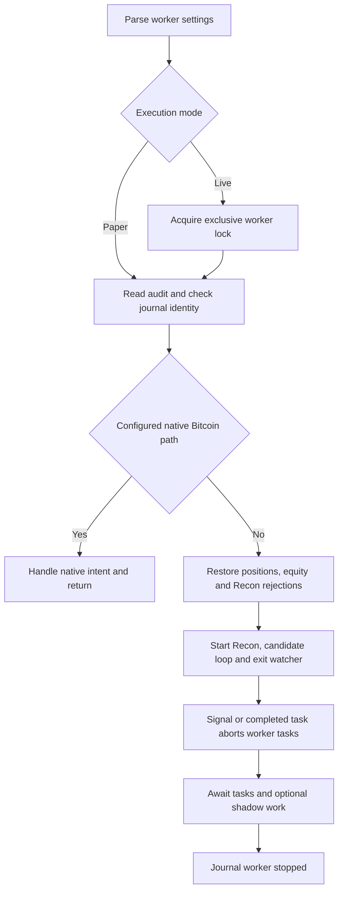
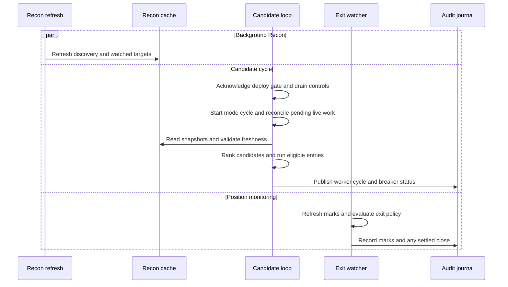
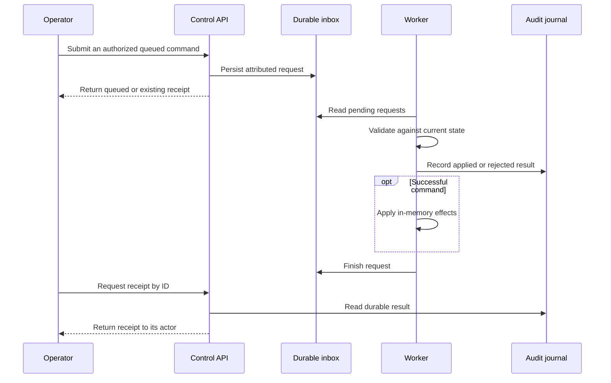
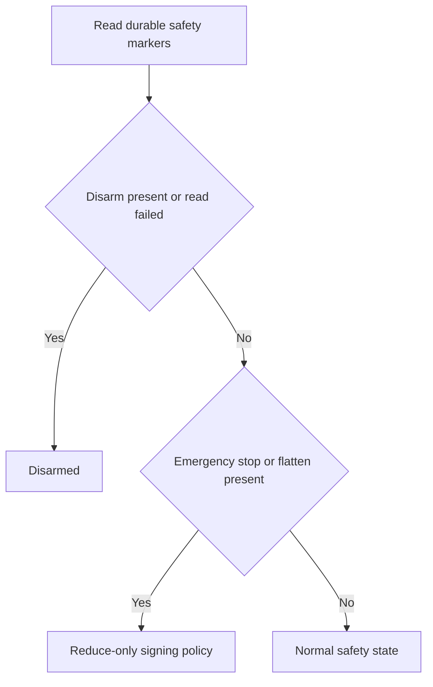
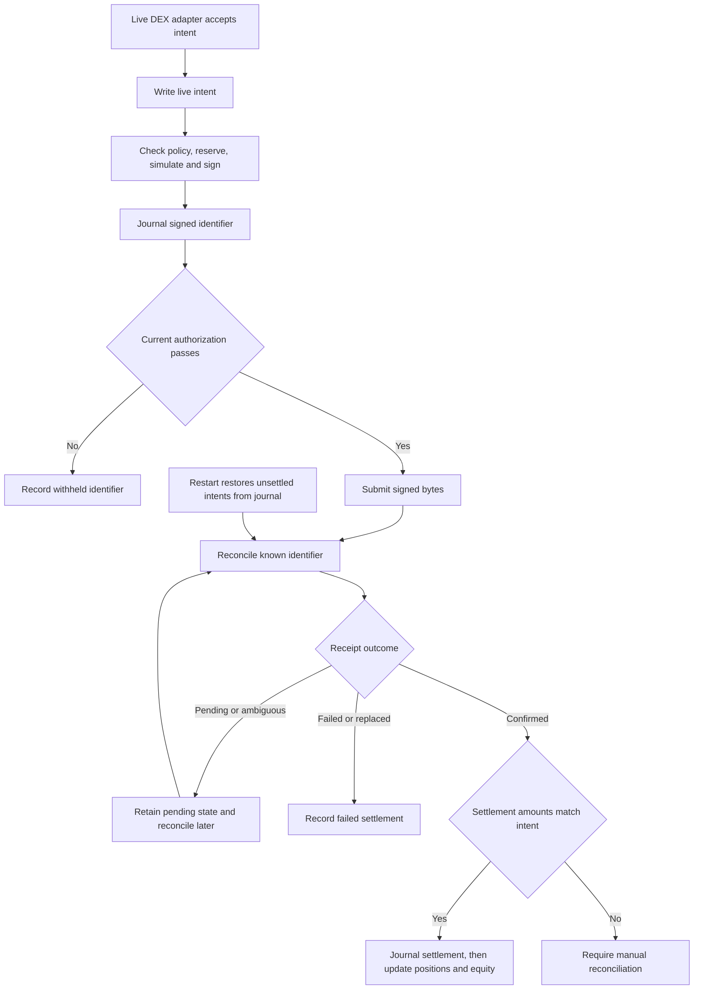
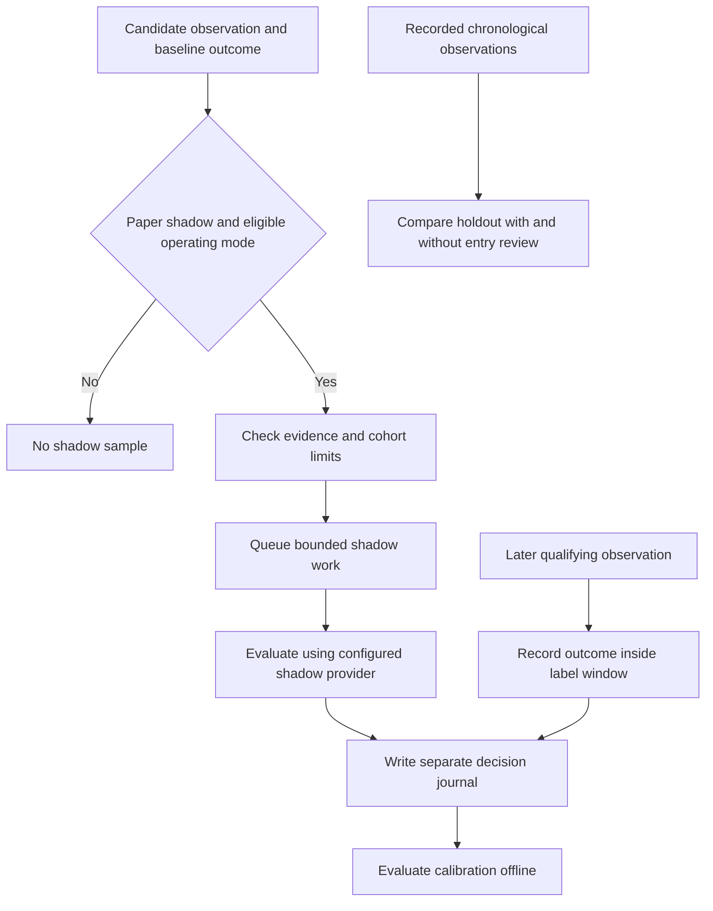

# Runtime and state flows

[Documentation index](README.md) · [Architecture audit](architecture-audit.md)

The diagrams describe the worker and its adjacent processes. They omit provider-specific quote payloads and configuration values. Follow the linked source and runbooks for current contracts and operator procedures.

## Worker startup and shutdown

The standard startup path publishes `worker_replay` before `worker_lifecycle` reports running. The live lock is released in `finally` during normal unwinding. A failure can prevent the stopped event from being written. The native Bitcoin path has its own intent handling and returns before starting DEX loops. [Worker composition](../src/index.ts) · [Restore test](../tests/integration/worker-state-restore.test.ts)

## Candidate cycle and independent monitoring

The three tasks share in-process state and one audit writer. The candidate loop applies backoff after repeated system failures. The watcher sleeps between sweeps, so market-data I/O affects the observed cadence. A protective exit can bypass optional model input and still requires usable market evidence and applicable execution checks. [Recon](../src/orchestrator/recon-refresh.ts) · [Candidate loop](../src/orchestrator/loop.ts) · [Exit watcher](../src/exits/watcher.ts)

## Operator commands and immediate safety

The sequence covers the inbox path. Some valid commands write a risk or configuration revision before their control receipt. Immediate safety controls use a separate durable marker path. A receipt for a flatten request records activation of that request. Position closures are confirmed separately. [Worker controls](../src/control/worker.ts) · [Control service](../src/control/service.ts) · [Routes and permissions](dashboard-api.md)

Normal safety state is one condition for signing. Configured arming, deployment authorization, deadlines, simulation, and wallet limits still apply. A marker can block new signing while receipt reconciliation continues. [Safety gate](../src/control/safety.ts) · [Signer checks](../src/wallet/signer.ts) · [Safety controls](dashboard-api.md)

## Live DEX settlement and recovery

Earlier denials can stop the path before signing. For composed live DEX entries, the signer checks the risk revision before preparation, before signing, and after the signed identifier is persisted. A confirmation is validated against the exact input and minimum output. Recovery queries previously recorded identifiers without a new trade submission. When an intent has no signed attempt to reconcile, recovery can settle it as not landed. The separate native Bitcoin path has adapter-specific replacement behavior. [Live DEX adapter](../src/wallet/live.ts) · [Signer and receipt recovery](../src/wallet/signer.ts) · [Live runbook](live-runbook.md)

## Shadow decisions and offline evaluation

Shadow inference can be dropped when its queue is full. A decision can lack a later qualifying outcome. The shadow path and paired replay do not apply commands or submit transactions. Separately configured Jev buy and sell review is an opt-in decision path and is distinct from shadow evaluation. [Composition and eligibility](../src/index.ts) · [Shadow queue and labeling](../src/decisions/shadow.ts) · [Learning and replay](modular-platform.md#hermes-and-standalone-research)

## Find the right evidence during diagnosis

| Question | Inspect |
| --- | --- |
| Did the worker restore state and finish a cycle? | `worker_replay`, `worker_lifecycle`, `worker_cycle`, and `breaker` in the authoritative audit journal. The loopback deploy probe exposes build and journal freshness data. [Dashboard routes](../src/dashboard-api/routes.ts) |
| Did an operator command reach the worker? | Read the actor-scoped receipt by request ID. Compare the inbox request with the worker's `control` audit result. [Dashboard API](dashboard-api.md) |
| Did a live intent settle? | Correlate `live_intent`, signer `wallet` records, and `live_settled`. A pending or ambiguous receipt needs reconciliation. [Live runbook](live-runbook.md) |
| Why is the dashboard status behind the worker? | Distinguish a stale cycle from an unreadable journal or disconnected stream. Compare REST/SSE state with the worker audit. [Deployment guide](../deploy/README.md) · [Dashboard API](dashboard-api.md) |
| Where did an optional decision go? | Look in the configured shadow journal for shadow predictions and outcome labels. Use the authoritative audit for configured decision gates and trading review. [Platform guide](modular-platform.md) |

Keep credentials and raw transaction material out of operational logs and attached diagnostic files. Use [the secrets runbook](secrets-runbook.md) for handling configuration and credentials.
