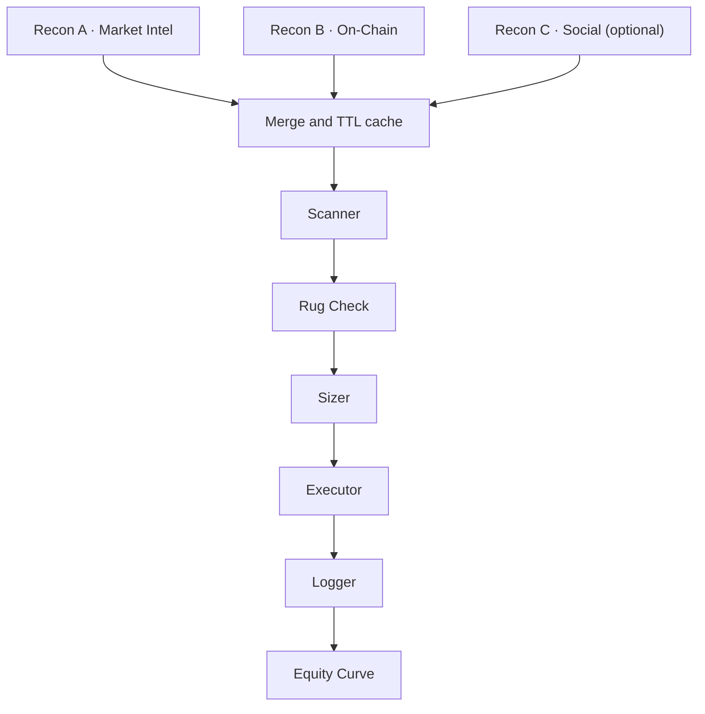

# Pipeline

- Recon A and B run concurrently per watchlist candidate. Recon A uses DexScreener and GeckoTerminal. Recon B uses GoPlus and a chain-specific companion, Honeypot.is on EVM or RugCheck.xyz on Solana. Recon C can run concurrently when enabled and summarizes its supplied observations. The default entry point supplies an empty social observation list.
- Mandatory sources retain independent timestamps. Cache entries are keyed by normalized chain, token, and pair. Expiry is exclusive and uses the earlier of the two mandatory timestamps plus each source's TTL. The Executor rechecks freshness immediately before the simulated fill. Timestamps describe the start of the local fetch, while providers may cache the upstream data.
- The model can veto or recommend. Code requires all mandatory evidence, blocks flagged or unknown assessments, caps per-position spending and available cash, and checks open positions. Price and liquidity are extracted from provider data. Market quotes are indicative and security findings cover only the fields evaluated by the adapters.
- Candidate errors skip a candidate. Repeated system errors suspend the loop for the configured cooldown. The loop resumes on a probe and stops on a failed audit write. SIGINT and SIGTERM stop subsequent work.
- The JSONL writer queues appends, flushes fills before they enter in-memory state, and records evidence gaps. The paper equity ledger owns `current_equity` and updates it from open-position marks. The Equity Curve model supplies commentary. Keep one writer per journal.
- Code is the only signing authority. The shipped entry point records simulated positions and performs zero transactions. The offline signing entry point accepts a trusted, prebuilt transaction. A live adapter must validate quote binding, permitted routes and recipients, slippage, balance, fees, nonce or blockhash, simulation, broadcast idempotency, and settlement before it can replace the paper execution path. The optional loopback sidecar client is intended for a separately deployed signer.

[DexScreener](https://docs.dexscreener.com/api/reference) · [GeckoTerminal](https://api.geckoterminal.com/docs/index.html) · [GoPlus](https://docs.gopluslabs.io/reference/api-overview) · [Honeypot.is](https://docs.honeypot.is/ishoneypot) · [RugCheck](https://api.rugcheck.xyz/swagger/index.html)
