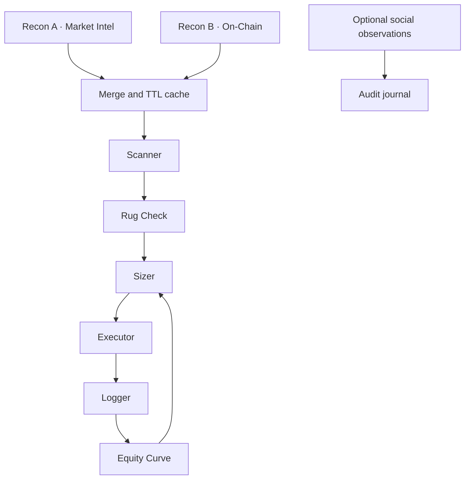

# Pipeline

See the [source-verified architecture audit](architecture-audit.md) for runtime composition, extension boundaries and the current deployment options. See [runtime diagrams](architecture-flows.md) for execution, recovery and control flows.

- Background refresh runs Recon A discovery and passes observed age to Recon B. Model-backed stages use the configured reasoning adapter and validated function calls where supported. Configured social sources run separately and publish observations to the audit journal.
- Cache entries use normalized chain and token and verify the pair at lookup. Evidence expires after five minutes for new tokens and one minute for watched tokens. The worker restores permanent Rug Check rejections from the journal. A single worker Scanner request ranks the eligible feed for each cycle.
- The model can veto or recommend. Code requires all mandatory evidence, blocks flagged or unknown assessments, caps per-position spending and available cash, and checks open positions. Price and liquidity are extracted from provider data. Market quotes are indicative and security findings cover only the fields evaluated by the adapters.
- Candidate errors skip a candidate. Repeated system errors suspend the loop for the configured cooldown. The loop resumes on a probe and stops on a failed audit write. SIGINT and SIGTERM stop subsequent work.
- The JSONL writer queues appends, flushes fills before they enter in-memory state, and records evidence gaps. Equity Curve publishes current equity from closed trades. The dashboard reads its audited publication. Internal mark-to-market and cash calculations impose additional spending limits. Keep one writer per journal.
- Code is the only signing authority. The default worker records simulated positions. Configured live DEX execution uses the composed wallet adapter and its intent, simulation, arming and reconciliation checks. Configured native Bitcoin uses a separate path in the worker. The offline signing entry point accepts a trusted, prebuilt transaction, and the loopback sidecar client is separate from the composed wallet path.

[DexScreener](https://docs.dexscreener.com/api/reference) · [GeckoTerminal](https://api.geckoterminal.com/docs/index.html) · [GoPlus](https://docs.gopluslabs.io/reference/api-overview) · [Honeypot.is](https://docs.honeypot.is/ishoneypot) · [RugCheck](https://api.rugcheck.xyz/swagger/index.html)

## Portfolio loss budget

Before a paper entry, the worker reserves cash equal to peak marked equity
minus the configured drawdown allowance. Only cash above that reserve can
fund another position. This treats every existing holding and the proposed
purchase as capable of losing their entire value. For example, with a
$1,000 peak and a 15% allowance, $855 in uncommitted cash leaves $5 for
new entries. Per-position and pool limits can reduce that amount further.

After Executor responds, the worker reloads the risk settings and checks
the portfolio again before journaling a fill. Tightening the budget blocks
an outstanding proposal. This governs new exposure in the single-worker
paper ledger. Existing holdings can fall, marks can lag, and legacy paper fills
assume zero trading costs unless the configured cost model or a strategy-specific quote path applies.
