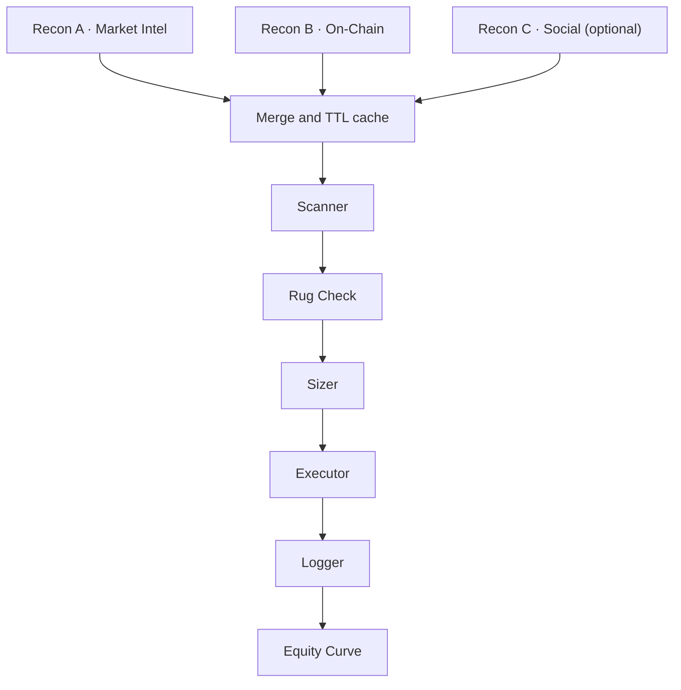

# Pipeline

- Background discovery targets a 60-second cadence. New tokens get a 300-second TTL and one refresh after 10 minutes if their pool remains under observation. Watchlist entries and holdings refresh every five minutes with a 60-second TTL, so expired snapshots are skipped until refresh. Slow provider calls may delay publication.
- Recon A uses the existing DexScreener and GeckoTerminal functions. Recon B uses GoPlus and Honeypot.is on EVM or RugCheck.xyz on Solana. Both use Responses function calls. The worker leaves social disabled. A normalized snapshot can carry optional social evidence.
- Cache keys are normalized chain and token. The snapshot pair must match the requested pool. Numeric observations retain their source and fetch timestamp. A miss or expired snapshot records stale_recon. A fresh market failure records recon_a_missing. Executor rechecks freshness before a simulated fill.
- Scanner reads cached feed. Rug Check reads cached safety evidence using TypeScript and fails on missing critical checks, failed critical sources, and conflicting critical fields. A FAIL suppresses entry Recon refreshes for 24 hours. Active rejections are restored from the journal. Sizer receives liquidity from Scanner output.
- Candidate errors skip a candidate. Repeated system errors suspend the loop for the configured cooldown. The loop resumes on a probe and stops on a failed audit write. SIGINT and SIGTERM stop subsequent work.
- The JSONL writer queues appends, flushes fills before they enter in-memory state, and records evidence gaps. The paper equity ledger owns `current_equity` and updates it from open-position marks. The Equity Curve model supplies commentary. Keep one writer per journal.
- Code is the only signing authority. The shipped entry point records simulated positions and performs zero transactions. The offline signing entry point accepts a trusted, prebuilt transaction. A live adapter must validate quote binding, permitted routes and recipients, slippage, balance, fees, nonce or blockhash, simulation, broadcast idempotency, and settlement before it can replace the paper execution path. The optional loopback sidecar client is intended for a separately deployed signer.

[DexScreener](https://docs.dexscreener.com/api/reference) · [GeckoTerminal](https://api.geckoterminal.com/docs/index.html) · [GoPlus](https://docs.gopluslabs.io/reference/api-overview) · [Honeypot.is](https://docs.honeypot.is/ishoneypot) · [RugCheck](https://api.rugcheck.xyz/swagger/index.html)
