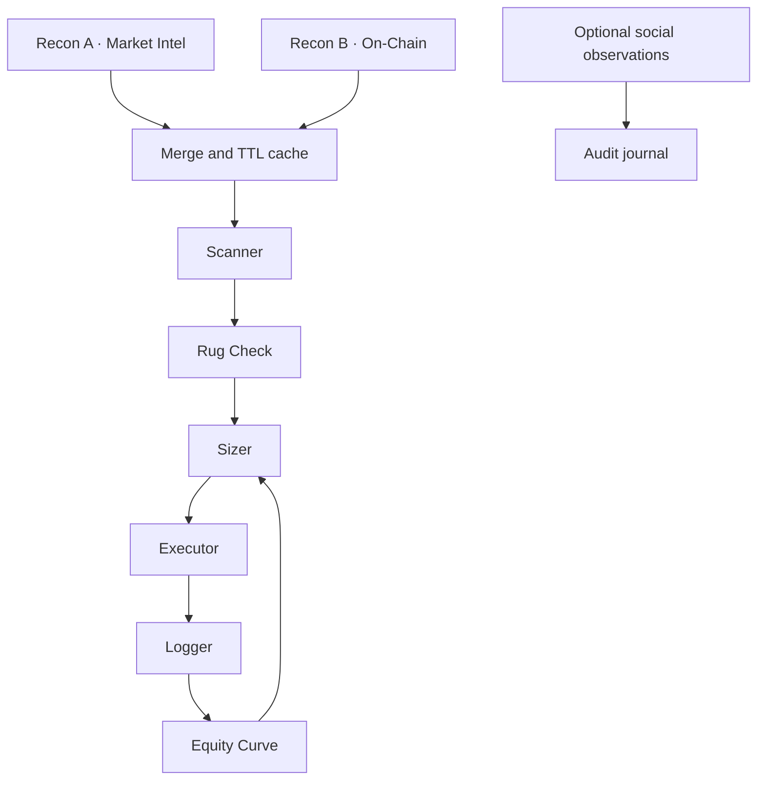

# Pipeline

- Background refresh runs Recon A discovery and passes observed age to Recon B. The worker uses Responses function calls. Configured social sources run separately and publish observations to the audit journal.
- Cache entries use normalized chain and token and verify the pair at lookup. Evidence expires after five minutes for new tokens and one minute for watched tokens. The worker restores permanent Rug Check rejections from the journal. A single worker Scanner request ranks the eligible feed for each cycle.
- The model can veto or recommend. Code requires all mandatory evidence, blocks flagged or unknown assessments, caps per-position spending and available cash, and checks open positions. Price and liquidity are extracted from provider data. Market quotes are indicative and security findings cover only the fields evaluated by the adapters.
- Candidate errors skip a candidate. Repeated system errors suspend the loop for the configured cooldown. The loop resumes on a probe and stops on a failed audit write. SIGINT and SIGTERM stop subsequent work.
- The JSONL writer queues appends, flushes fills before they enter in-memory state, and records evidence gaps. Equity Curve publishes current equity from closed trades. The dashboard reads its audited publication. Internal mark-to-market and cash calculations impose additional spending limits. Keep one writer per journal.
- Code is the only signing authority. The shipped entry point records simulated positions and performs zero transactions. The offline signing entry point accepts a trusted, prebuilt transaction. A live adapter must validate quote binding, permitted routes and recipients, slippage, balance, fees, nonce or blockhash, simulation, broadcast idempotency, and settlement before it can replace the paper execution path. The optional loopback sidecar client is intended for a separately deployed signer.

[DexScreener](https://docs.dexscreener.com/api/reference) · [GeckoTerminal](https://api.geckoterminal.com/docs/index.html) · [GoPlus](https://docs.gopluslabs.io/reference/api-overview) · [Honeypot.is](https://docs.honeypot.is/ishoneypot) · [RugCheck](https://api.rugcheck.xyz/swagger/index.html)
