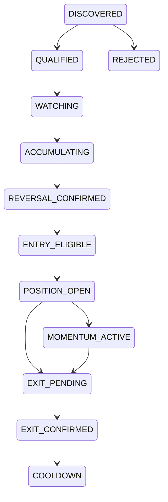

# Early momentum reversal

Strategy `early-momentum-reversal`, version 1, is a disabled-by-default strategy for paper experiments. It uses the existing registry, Scanner, Rug Check, Sizer, Executor handoff, operator approval, risk limits and portfolio journal. The strategy itself makes no network or AI calls. Existing positions retain their recorded exit policies.

## Discovery and evidence

The global Scanner minimum age is 600 seconds. The default `new-pair-momentum` and `new-pool-snipe` limits are strictly below 600 and 180 seconds, respectively. Their default age conditions cannot overlap the Scanner floor. This strategy starts at 600 seconds and retains the global floor. Its defaults require USD 30,000 of pool liquidity and USD 15,000 in hourly volume. The independent candle history requirement needs at least 12 consecutive minutes with the default windows. While enabled in a paper strategy mode, recon schedules a bounded recurring scan of discovered pools that meet these strategy floors and remain visible in the configured discovery scope. Standard watchlist and discovery rules still apply.

Discovery and positions use chain, token contract or mint, and pool address. The discovery provider deduplicates candidate pools by chain and token. The managed strategy blocks simultaneous positions of the same token across pools, even if a different strategy would place the second order. Contracts with similar metadata remain distinct assets. Copycat screening requires an explicit detector result. Pool creation and token creation have separate timestamps. The strategy uses pool age for qualification, rejects an old token when its independent timestamp is known, and records unknown token age separately.

A trusted collector supplies the existing `STRATEGY_EVIDENCE_PATH` JSONL. Replace the file atomically and preserve a terminating newline. The worker checks the row's time and target, the closed-candle timeline, exact quote quantity, per-quote timestamp and expiry. Keep the evidence writer independent of trading and wallet secrets. New fields are defined in [the versioned evidence schema](../schemas/early-momentum.ts). Required data includes USD-denominated one-minute OHLCV, a prior pool liquidity observation, five-minute buys and sells, sell-simulation status, and fresh buy/sell offers for matching quantities.

```json
{
  "target": {
    "chain": "base",
    "token": "0x1111111111111111111111111111111111111111",
    "pair": "0x2222222222222222222222222222222222222222"
  },
  "source": "trusted-collector",
  "fetched_at": 1800000000000,
  "sell_simulation": true,
  "early_momentum": {
    "poolCreatedAt": 1799998260000,
    "liquidityUsd": 100000,
    "priorLiquidityUsd": 99000,
    "priorLiquidityAt": 1799999700000,
    "activity": { "windowSec": 300, "buys": 40, "sells": 20 },
    "candles": [],
    "offers": []
  }
}
```

This minimal schema example deliberately waits for candles and quotes. Each quote specifies `observedAt`, `expiresAt`, `route`, `tokenAmount`, `grossCents`, `tradingFeeCents`, `networkFeeCents`, `transferFeeCents`, `slippageCents`, and `impactCents`. Use pre-cost USD value for `grossCents` and mutually exclusive deductions. Entering zero for a cost means the collector has evidence that the cost is zero. Convert chain and token fees to USD at the observation timestamp. Publish `liquidation` at the actual held token quantity for every open position. The strategy waits if an executable sell route is unavailable. Existing signer quote adapters remain on their original execution paths.

```bash
npm run evidence:candles -- '{"chain":"base","token":"TOKEN_ADDRESS","pair":"POOL_ADDRESS"}'
```

The read-only helper fetches one-minute pool OHLCV from [GeckoTerminal](https://api.geckoterminal.com/docs/index.html) and drops incomplete intervals. It can supply the candle portion of an evidence record. The [response format](https://docs.coingecko.com/reference/pool-ohlcv-contract-address) orders the tuple as time, open, high, low, close and volume. The helper does not produce swap quotes, buy counts, or sell-simulation attestations.

## Causal signal and scoring

| Condition | Version 1 rule |
| --- | --- |
| Pivot and pullback | A high or low is strictly greater or smaller than its `swingRadius` neighbors on both sides. Count it only after the right-hand candles close. The latest sequence of three pivots must contain two consecutive increases in swing lows. Divide the first low by the highest preceding confirmed pivot high, subtract from one, and require a 10–40% decline. |
| Reversal | At least two consecutive bullish candles with increasing closes after the final swing low. The last close and current mark must exceed the maximum intrabar high between the first and last swing lows. The current mark must remain within 8% above the confirmation close. Quote implied prices must also match the mark within the extension limit. |
| Volume | Average USD volume over the latest three closed candles divided by the average over the preceding nine closed candles. Require at least 1.5× and a positive comparable baseline. Candle windows must have consecutive minute timestamps. |
| Buyers | At least 20 transactions in five minutes and buys at least 60% of the total. If unique buyers are available, a unique-buyer count below 20% of buys blocks the candidate when buys meet the sample floor. |
| Liquidity | Current liquidity must stay within 3% of the prior observation. Baseline age must be one to ten minutes. Pending policy can use independently observed liquidity for deterioration exits. |
| Risk | Mandatory Rug Check, sell simulation, known top-ten concentration at or below the strategy ceiling, quote and slippage caps, and global authorization must all pass. An explicit flagged manipulation or token-risk check blocks the candidate. |

Scores are bounded to 0–100. Multiply each factor by its configured weight and sum. Version 1 weights are reversal 20%, volume 20%, liquidity 20%, buyers 15%, holders 10%, momentum 10%, social 5%.

- Reversal contributes its full weight after confirmed structure and breakout.
- Volume scales as `0.8 × acceleration / configured minimum`, and buyers scale as `0.85 × buy ratio / configured minimum`, each capped at one.
- Liquidity clamps `0.9 + 5 × fractional liquidity change` to zero through one.
- Holder growth uses the most recent causal baseline from 5–60 minutes earlier and saturates at 5% growth. Missing holder history gives zero.
- Momentum uses a 15-close RSI sample and the 9/21 EMA relationship once 22 closed candles are available. It logs crossover direction and recent lower-high/lower-low structure. Missing history gives zero.
- Social activity has zero weight in the result unless independent evidence explicitly clears the artificial-social check and supplies a normalized score.

Scores under 40 reject, 40–59 observe, 60–79 watch, 80–89 are entry-eligible, and 90–100 are high priority. A candidate can have a high numerical score and still fail a required gate. The score ranks opportunities and has no empirical probability interpretation. Wash trading, coordinated activity, creator clusters, suspicious authorities, transfer restrictions and related detections are explicitly `unknown` unless the collector supplies evidence. Neither numeric volume nor the absence of a flag establishes organic trading.

## Position lifecycle and journal



A candidate audit row records the causal path, score contributions, evidence times, checks and rejection reason. Fill, monitor and close events share the authoritative journal and original run ID. The deterministic Sizer and final risk refresh cap the paper commitment. The fill uses a size-matched offer within that cap, with the all-in buy cost persisted. The worker never invents a fill for a missing or expired quote. The authoritative paper ledger records net proceeds, holding time, observed excursion, cost components, and cooldown on close. The existing trade history and performance projections use those proceeds.

A 500-bp initial stop compares executable liquidation proceeds to the all-in entry cost. Fixed mode seeks a 1,000-bp net gain. Trailing mode activates at a 1,000-bp net gain and ratchets a floor 500 bp below the peak liquidation value. It has no fixed liquidation at the activation point. The highest valid quoted price, peak liquidation value, floor and pending cause replay from the journal. A 3,600-second time limit, 25% liquidity deterioration threshold, and three contiguous falling bearish candles cover other exits. Discretionary pause suppresses new candle-deterioration exits. Manual and emergency exits retain priority. A triggered exit waits for a fresh, size-matched sell quote if the market stops quoting. A stop triggers an attempted exit and cannot guarantee the eventual fill price or limit a gap loss.

Existing trade exit reason values remain `target`, `timeout`, `stop` and `manual`. The detailed reason is in the close audit event. The trailing chart's configured target is the activation reference, with the ratcheted stop in the position audit events. Cooldown starts when the close is recorded and applies across pools for that token. The global Scanner deduplication window can further defer reconsideration.

## Paper deployment

1. Set `EXECUTION_MODE=paper`, use a separate audit and control directory, and enable the existing watchlist or discovery. Set `STRATEGY_EVIDENCE_PATH` to a read-only mount supplied by the trusted collector. Use deterministic `strategies` mode for the first run. Base remains the default chain.
2. Verify evidence rows and control receipts in the existing API. Submit parameters to `POST /api/v1/strategies/early-momentum-reversal/params`. Then enable the strategy through `POST /api/v1/strategies/early-momentum-reversal/enable`. Under the existing authorization policy, wait for both durable worker receipts. For an isolated experiment, explicitly disable other entry strategies or use a separate paper configuration.
3. Check the strategy listing, audit, position history and performance by strategy for fills and exits. Keep the collector running while positions remain open. Disabling the strategy stops new signals and keeps monitoring recorded positions. Older images cannot parse the managed policy field in a journal that contains these positions. Keep the current image for that journal, or use a compatible paper journal for rollback.

Example parameter request body

```json
{
  "params": {
    "version": 1,
    "style": "trailing",
    "initialStopBps": 500,
    "trailActivationBps": 1000,
    "trailDistanceBps": 500,
    "maxHoldSec": 3600,
    "cooldownSec": 3600,
    "minScore": 80
  }
}
```

To compare an alternative with a full fixed exit, set `style` to `fixed` and `takeProfitBps` to `1000`. The per-position policy records the selected style at fill.

## Jev, Hermes and replay

Enable the existing separate `DECISION_SHADOW` journal in paper hybrid mode and set `scope:"early_momentum"`. Keep the existing budgets and credentials. Use an exact all-in `notionalCents` represented in the evidence. Label only a later executable net liquidation quote with the sampled token quantity. Opportunities that never quote again stay unlabeled. The observer cannot change entry or exit behavior. Configure a label window wide enough to account for the actual candidate loop cadence. See [the shadow calibration guide](modular-platform.md#extend-a-decision-provider).

### Let Jev approve paper execution

Set `EXECUTION_MODE=paper`, `OPERATING_MODE=hybrid`, and mount `AI_GATEWAY_API_KEY_FILE`. Enable the strategy separately through its existing control. Hybrid's paid reasoning advisory may stay disabled. Configure `JEV_PAPER_ENTRY` with the exact verified response model ID and explicit budget limits.

```dotenv
JEV_PAPER_ENTRY={"responseModels":["typesafe-ai/jev"],"approvalThreshold":0.85,"timeoutMs":1500,"dailyBudgetUsd":0.10,"maxCostPerRequestUsd":0.01}
```

The example amounts are reservation limits. Set the per-request reservation based on your account's verified maximum request cost. The worker reserves that amount in a separate journal and uses a dedicated paper-entry audit stage. The model sees only numerical market facts and the already selected paper economics. An approval can advance one qualifying Early Momentum Reversal entry to the existing Executor. Skip, abstention, approval below the threshold, expiry, outage, or exhausted budget skips that entry. The normal human authorization, risk refresh, quote checks, and pause controls still apply. Exits and unrelated strategies continue through their existing paths.

Clear `JEV_PAPER_ENTRY` and restart the paper worker to resume deterministic handling. The `DECISION_SHADOW` setting remains independent. If both are enabled, their requests count against their own budgets.

Use the standalone Hermes research CLI and read-only MCP to review candidate, fill, monitor, and close audit events. Seed research with recorded rejections and unfilled opportunities as well as outcomes. Hermes may propose parameter changes. The normal strategy control and its operator approval own configuration changes.

Replay through `npm run research:replay -- REPLAY_SPEC.json`. Use one canonical pool per chain and token in a tape and provide point-in-time quote, candle, liquidity, and Rug Check evidence. The replay fills at the next eligible observation and uses the managed policy for the same net exit logic. Legacy baselines use the configured paper-cost model. Supported comparisons include `dip-buy`, `new-pair-momentum`, `momentum-ladder`, `new-pool-snipe`, `no-trade`, and `combined-deterministic`. Replay reports net expectancy and return, drawdown on realized equity, frequency, cost, execution success, MFE/MAE, and the fraction of closed positions with no positive observed excursion. Use chronological forward validation and preserve censored outcomes and rejected assets in the input tape.

```bash
npm run bench:early-momentum
```

The benchmark times deterministic evaluation and runs the same synthetic tape through all seven strategies. It includes advances, a collapse, a delisted route, a failed buy route, a Rug Check rejection and insufficient liquidity. It is a behavior check. Production approval requires independent time-ordered data, actual execution assumptions and out-of-sample evidence.

## Verification and limitations

The Node 20.19.6 run passed lint, build, **162 tests**, and **6 paper simulations**. Production TypeScript emit, harness policy generation, route inventory, and deploy timing checks passed. Prompt files match the parent revision. A read-only GeckoTerminal request for the Ethereum USDC/WETH pool returned 119 closed one-minute candles. That smoke check covers the public candle adapter.

A 20,000-evaluation fixture run measured **0.010 ms p50**, **0.019 ms p95**, and **0.053 ms p99**, at **70,374 evaluations/s**. It excludes collection I/O and audit writes. The 23-observation synthetic replay produced the following counts and realized net P&L.

| Strategy | Entries filled | Closed | Still open | Realized net P&L |
| --- | ---: | ---: | ---: | ---: |
| Early momentum reversal | 3 | 2 | 1 | −$7.02 |
| Momentum ladder | 5 | 1 | 4 | +$1.83 |
| Combined deterministic | 5 | 1 | 4 | +$1.83 |
| Dip buy | 0 | 0 | 0 | $0.00 |
| New-pair momentum | 0 | 0 | 0 | $0.00 |
| New-pool snipe | 0 | 0 | 0 | $0.00 |
| No trade | 0 | 0 | 0 | $0.00 |

The managed strategy recorded one failed entry and one pending exit without a route. Legacy baselines have different exit policies and use configured paper costs. The comparison demonstrates fixture behavior and leaves realized outcomes for open positions censored.

A complete read-only quote and sell-simulation collector, independent organic-demand detectors and a representative historical tape remain deployment prerequisites. Authenticated Jev and Hermes sessions were outside the executed tests. Paper fills model observed quote economics and skip trades when evidence is missing. Paper execution does not generate on-chain failed-transaction debits, and the replay lacks a historical failed-fee and real confirmation-latency model. Unavailable exits remain visible as open or pending positions, so realized-return metrics should be read alongside exposure and labeling coverage.
