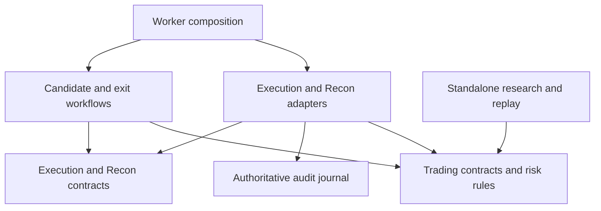

# Modular platform engineering report — entry safety and paired evaluation

## Starting point and reused components

The initially clean checkout was on `strategy/early-momentum-reversal` at local commit `4bfc0fadd468be27c4ec988f551cb29f0a1d4bda`. The published branch was at `d6131adf73cf1c519192948455a29d84171d26ca` with identical files. GitHub `main` was at `13b93732889d067d3853689c8e9872f937fa47b1`. The checkout and its workspace parents contained no `AGENTS.md`. Node v20.19.6 passed the baseline build, lint, 169 tests and six simulations.

The checkout already had the nine original agents, Merge, the Recon cache, the strategy registry, Early Momentum Reversal, deterministic operation, calibrated-metrics tooling, three separate intelligence contracts, an optional Hermes research process, Jev shadow and opt-in trading integration, live simulation and reconciliation, and authorized REST and MCP. This change reuses these implementations and existing deployment workflows. The [initial architecture report](modular-platform-report.md) documents the earlier migration and its starting point.

## Phase coverage

| Phase | Finding and implementation | Remaining evidence or work |
| --- | --- | --- |
| Boundaries | The worker, exit watcher and control plane now use `ExecutionPort` and/or `ReconStore` where they previously referred to their concrete classes. The worker composes the current implementations. Architecture tests enforce these import boundaries and keep learning, reasoning, decisions and runtimes independent of execution and signing. | Generalize discovery and detailed token-security data, quote and RPC selection, persistent stores, notifications and telemetry exporters when a second implementation or workload establishes the contract. |
| Reasoning | The existing capability router now supports up to two opt-in jittered retries for normalized transient inference failures and timeouts. Each attempt reserves budget. Authentication, 429 handling, partial streams and existing fallback retain their existing routes. | Authenticate the exact deployed model combinations and verify billed costs, failure handling and usable context limits. |
| Typed decisions | The existing typed adapters and shadow journal are retained. Paired evaluation compares a deterministic baseline to a recorded entry filter after costs using the same training-selected strategy, chronological holdout and fill rules. Unavailable, replayed, stale and mismatched evidence fails closed. | Record representative Jev decisions and later outcomes. Build a governed evidence export where shadow records lack comparable execution observations. Compare discretionary exits separately. |
| Hermes | Retains the dedicated, separately configured research process and server-enforced read-only MCP scope. No Hermes dependency was added to trading or protective exits. | Validate a pinned daemon, restrictions and each intended upstream model with the real three-hop check. |
| Execution safety | The composed live DEX entry path binds the effective risk revision to the canonical intent hash. The signer rechecks around asynchronous work. Paper commits are serialized within one book to prevent duplicate fills and stale concurrent capacity reads at commit. | Full per-chain intent conformance, outage workload and test-chain lifecycle validation. Multiple writers sharing one position journal are outside this design. |
| Learning and realism | Existing cost-aware paper fills and Early Momentum Reversal quote-aware paper tracking support local tests. Paired replay reports outcome deltas without influencing execution. | Representative point-in-time data including failed, delisted and illiquid pools, executable quotes, delayed fills and actual failed transaction costs. Parameter promotion stays with the operator. |
| Performance and readiness | Repeated synthetic baseline and post-change candidate benchmarks using the existing script. Checked compatibility with tests and local deployment checks. | Measure external provider, RPC, broadcast and receipt latency in a representative paper or test-chain environment and verify container startup and rollback on a Docker host. |

## Dependency graph and execution ownership

The worker performs final entry checks after existing approval. For the composed live DEX path, the execution adapter supplies the exact intent to the signer along with a function that rechecks the accepted risk revision and active entry authorization. The signer retains its intent validation, authorization, arming and receipt handling. The new `wallet_authorization` audit stage carries the existing run ID, a revision fingerprint and an intent hash. It contains no raw transaction or credentials. A withheld signature uses the existing wallet state transition. Previously submitted transactions remain subject to reconciliation. Entry revision checks leave reduce-only exits independent.

The paper workflow commits the journal record before updating the position book. One in-process reservation serializes this work and releases on failure. A second attempt can be reevaluated on a later cycle. The JSONL journal remains the recovery authority under the existing one-writer deployment model. See [ADR 0007](adr/0007-entry-authorization-and-replay.md).

## Confirmed defects and modeling limitations

| Finding | Effect and disposition |
| --- | --- |
| Concurrent paper fills passed checks against the same position-book state. | Reproduced with a held first journal write. The book now allows one paper entry commit at a time. |
| An edited risk revision could land during signing or its durable write. | Reproduced with a mocked signer adapter. The composed DEX entry path now rechecks and records the revision against the exact intent. Legacy direct signer calls and the Bitcoin path retain their established contracts. |
| Legacy paper can ignore fees and slippage. | `PAPER_COSTS` remains an opt-in with persistent fees, slippage and fixed charges. Early Momentum Reversal paper with qualified execution evidence uses executable quote economics. |
| The Sizer receives zero volatility and zero gas. Executor advisory receives zero gas. | Confirmed in the existing pipeline. Actual live wallets retain their separate simulation and fee constraints. A fee and volatility redesign requires validated data and operator review. |
| Optimistic fills and incomplete live cost accounting remain possible. | Legacy indicative fills and generic replay assumptions have limited execution evidence. Real failed costs, dynamic price impact, partial fills and transfer effects need verified inputs. Full settlement economics and cost attribution remain open. |
| Profit-only policy can leave losing positions open. | The legacy policy is preserved. Existing stop-loss and strategy-specific exits are opt-in. A stop can fail to execute at its threshold. |
| Default exit mark refresh is five seconds. | It is delay between sweeps. Sequential mark requests can make actual intervals longer. No latency guarantee was established. |
| Synthetic confidence and missing probability calibration. | Legacy human approval carries synthetic advisory metadata. Typed raw confidence remains separate from statistical calibration. Representative reliability and net utility for Jev remain unmeasured. |
| Hermes mutation handling. | The dedicated backend harness is read-only in local tests. There is no new mutation route. A real pinned daemon and its permissions still need conformance checks. |

The existing wallet's deny rules and reservations remain the authority on simulation, arming, fees and unresolved receipts. Entry revisions narrow the interval between approval and broadcast. Configuration reads, process state and remote submission do not share a single atomic transaction. Full portfolio exposure across multiple pools and execution adapters, real quote/program conformance and full cost attribution remain open.

## Configuration, deployment and rollback

The [platform guide](modular-platform.md) covers provider, decision, runtime, strategy, chain, market-mark and execution extension, the threat model and deployment. [Strategies](strategies.md), [Jev execution settings](early-momentum-reversal.md#enable-jev-to-buy-and-sell), and the [Hermes guide](hermes-integration.md) cover the existing integration points. The tested configuration-only compatible provider addition is in the existing reasoning router integration suite. The external endpoints and credentials were not used for that suite.

Use the current image and configuration in paper for integration validation. Optional retries default to zero and can be reverted by removing `retryLimit`. Paired replay runs offline and is omitted unless the replay spec opts in. Existing Jev trading defaults to off. Keep paper and research audit journals separate and back up the writer's journals before image rollback. Reconcile submitted intents first and verify older readers against the persisted record types. Use the [existing rollback runbook](rollback.md) for the operator-controlled restore. No infrastructure, environment file, live switch or default financial parameter changed during validation.

## Verification

| Check on Node v20.19.6 | Baseline | Published changes |
| --- | --- | --- |
| `npm run build` and `npm run lint` | Pass | Pass |
| `npm test` | 169 passed | 175 passed, zero failures |
| `npm run simulate` | 6 passed | 6 passed, zero failures |
| Harness policy, deployment timing and production TypeScript emit | Existing tests | All three checks passed |
| REST and MCP route inventory | Existing documented planning drift | Counts remain 13 REST routes with no MCP tool, 51 planned REST routes absent, 5 REST routes outside the plan, 92 planned MCP names absent in read-only mode and 8 MCP names outside the plan |
| Prompt files | Reference | No diff in `prompts/` or `docs/prompts/` |

A first full-suite attempt incorrectly muted logging and failed the existing wallet telemetry assertion. The logging-enabled rerun passed with the original assertion. Compatibility checks were local. Runtime validation used mocks and simulated accounting. No production deployment or real transaction was performed.

The benchmark ran the existing script on an original detached checkout and the proposed tree consecutively, with 100 warm-up cases and 3,000 measured deterministic paper fixture candidates in each run. It used an in-memory audit sink and omitted network I/O and fsync. Reproduce with `LOG_LEVEL=silent npm run bench:candidate -- PATH_TO_CHECKOUT 3000`.

| Fixture metric | Baseline | After changes |
| --- | ---: | ---: |
| Throughput | 594/s | 567/s |
| Latency p50 / p95 / p99 | 1.00 / 4.42 / 7.05 ms | 1.11 / 4.67 / 6.72 ms |
| Wall time / process CPU | 5.05 / 10.15 s | 5.29 / 10.51 s |
| CPU time per wall second | 2.01 s/s | 1.99 s/s |
| RSS at completion | 250.2 MiB | 275.1 MiB |
| Total GC | 1.37 s | 1.39 s |
| Event-loop delay p99 | 85.85 ms | 73.86 ms |

Throughput in this run was about 4.6% lower with mixed changes across latency percentiles. One pair does not establish a reliable regression or improvement. This comparison leaves network, signer, journal, model and receipt latency unmeasured.

## Modified files

| Area | Paths |
| --- | --- |
| Contracts and composition | `src/execution/port.ts`, `src/cache/{contract,recon-cache}.ts`, `src/control/worker.ts`, `src/index.ts`, `src/orchestrator/{loop,pipeline,recon-refresh}.ts`, `src/exits/watcher.ts` |
| Financial boundaries | `src/state/{positions,risk-config}.ts`, `src/wallet/{live,signer}.ts`, `src/strategies/early-momentum/monitor.ts` |
| Providers and offline learning | `schemas/provider-config.ts`, `src/providers/router.ts`, `src/learning/{recorded-entry-review,replay-cli,replay,walk-forward}.ts` |
| Tests and reference | `tests/integration/{paper-concurrency,risk-authorization}.test.ts`, `tests/unit/{module-boundaries,paired-replay,provider-retry}.test.ts`, this report, platform and strategy guides, [ADR 0007](adr/0007-entry-authorization-and-replay.md) |

## External verification and language strategy

Configuration-only reasoning switches, the extra compatible provider, Jev responses and Hermes API calls have local fixture coverage. The existing read-only MCP integration test starts the local backend stdio server. This leaves authenticated Kimi, GLM, DeepSeek and other exact model selections, authenticated Jev inference, a real Hermes daemon with its configured models, Docker deployment and test-chain execution outstanding. The host exposed neither Docker nor Hermes. Production-like data and paper telemetry are required for representative latency and out-of-sample trading evaluation.

TypeScript remains the implementation language. The fixture benchmark does not establish a bottleneck that justifies Go or Rust. Python remains an optional dependency of an external Hermes installation. Verify isolated vendor and Hermes connectivity, paper replay completeness and test-chain recovery before evaluating a live rollout. Any change to trading policy or strategy promotion remains operator-controlled.
