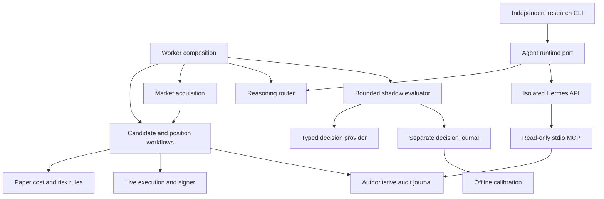

# Modular trading platform

Implementation [ADR 0006](adr/0006-modular-platform.md) · [Discovery and engineering report](modular-platform-report.md)

## Responsibilities and dependencies



| Module | Owns | Dependencies |
| --- | --- | --- |
| `src/domain/` | Cost arithmetic and versioned paper cost inputs | Zod |
| `src/orchestrator/`, `src/mode/`, `src/exits/` | Existing candidate ordering, mode delegation, required entry gate, position monitoring | Agent handoffs, risk, portfolio, market mark and execution ports |
| `src/providers/` | Reasoning requests, capability preflight, budgets, response parsing, caching and failover | Reasoning port, HTTP adapter and budget journal |
| `src/decisions/` | Bounded schemas and response reconciliation, entry decision, shadow evaluation | Decision port, fixed Gateway adapter, separate budget and journal |
| `src/agent-runtime/` | Advisory research workflow selection and fallback | Native reasoning router or dedicated loopback Hermes API |
| `src/market-data/` | Validated mark shape for recon and position monitoring | Provider-neutral contract, DexScreener adapter |
| `src/learning/` | Chronological evaluation, replay and walk-forward search | Recorded observations and existing pure strategy contract |
| `src/wallet/` | Exact intents, durable reservations, chain proof and reconciliation | Existing chain-specific quote, simulation, signing and RPC adapters |
| `src/control/`, `src/dashboard-api/`, `src/mcp/` | Existing operator authorization, commands and read projections | Worker inbox, journal readers, permissions and harness hard floor |

Keep one TypeScript workspace. The new boundaries are checked through the source dependency graph for cycles and signer, execution, and control-plane exclusions. The core still has legacy concrete dependencies within Recon and wallet composition. The extent of enforcement is covered in [the report](modular-platform-report.md).

## Configuration reference

| Setting | Default and behavior |
| --- | --- |
| `OPERATING_MODE`, `EXECUTION_MODE` | Defaults to `strategies` and `paper`. Strategies performs zero external AI calls. Human and pause retain existing routing and approval semantics. Hybrid retains existing stage advisory rules. |
| `MODEL_PROVIDER_DEFINITIONS` | JSON object keyed by provider ID. Each entry replaces that ID's complete repository definition. Changing its model or endpoint clears inherited stage tiers. Optional `stageModels` declares explicit overrides for models that share the entry's configured capabilities and rates. New IDs enter the default order when no explicit order is given. |
| `MODEL_PROVIDERS` | Existing comma-separated enable switch. Definitions can also set `enabled`. |
| `MODEL_PROVIDER_POLICY` | Existing order, mode, fallback categories and cooldown. Explicit order must include any ID you want routed. An applied control-journal order can take precedence at restart. |
| `PAPER_COSTS` | Optional paper-only JSON object with `version:1`, `feeBps`, `slippageBps`, and `fixedCents`, per leg. Persists with each position so changes apply to subsequent entries. Live startup rejects this setting. |
| `ENTRY_DECISION_MIN_LIQUIDITY_USD` | Optional paper-only deterministic entry gate. The number must be at least 15,000 USD. A rejection, abstention, or provider failure skips that entry. |
| `DECISION_SHADOW` | Optional JSON object for paper AI and hybrid. Common fields are `path`, `horizonMs`, `labelWindowMs`, `notionalCents`, and `costs`. Default provider `jev` additionally uses `responseModels`, `dailyBudgetUsd`, and `maxCostPerRequestUsd`. Provider `deterministic` uses `minLiquidityUsd` as a fixed heuristic and requires no service credential. Supply a distinct journal path and approved per-call budget ceiling. |
| `AI_GATEWAY_API_KEY_FILE` | Paper shadow only, with the existing secret-file mechanism. Uses a separate credential for the fixed Vercel Gateway endpoint. |
| `RESEARCH_RUNTIME`, `RESEARCH_FALLBACK` | Standalone CLI only, values `noop`, `native`, or `hermes`. Defaults to `noop` with no fallback. |
| `RESEARCH_BUDGET_PATH` | Required for native research. Give this process its own budget journal and billing limits. |
| `HERMES_RESEARCH_ORIGIN` | Required for Hermes research. Use a published API server bound to the numeric IPv4 or IPv6 loopback address. |
| `HERMES_RESEARCH_MODEL`, `HERMES_RESEARCH_API_KEY_FILE` | Set the deployed Hermes model ID and a dedicated API key mount. |
| `MARK_REFRESH_MS`, `PAPER_EXIT_MODE` | Existing 5,000 ms and profit-only defaults. Mark refresh is a sleep between sweeps. Configured stops use deterministic exit decisions. |

Provider settings are parsed at startup. Existing control-plane enable/order changes are applied through their durable receipts. Each agent request clones the current routing state at dispatch and carries a non-secret configuration fingerprint for provider audit. The in-flight tool rounds reuse that snapshot. Change endpoint, credentials or capability declarations through a controlled restart.

## Extend a reasoning provider

Use a configuration entry for an OpenAI-compatible endpoint. This example uses an isolated fixture origin. Use a reviewed endpoint and configure the exact model's capability and billing values before a real request.

```json
{
  "example": {
    "protocol": "openai-compatible",
    "enabled": true,
    "baseUrl": "https://fixture.example.test/v1",
    "model": "fixture-model",
    "apiKeyEnv": "MODEL_EXAMPLE_API_KEY",
    "timeoutMs": 4000,
    "capabilities": {
      "structuredOutputs": false,
      "jsonMode": true,
      "tools": false,
      "maxContextTokens": 16000,
      "costPerMTokIn": 0,
      "costPerMTokOut": 0,
      "cacheDiscount": 0
    }
  }
}
```

The adapter appends `/chat/completions`. Routing can skip an incompatible provider before reserving spend. JSON mode puts the schema in the prompt and validates the result locally. Strict JSON requires provider-side schema support. `toolsWithJson` and `requiredToolChoice` can disable unsupported combinations. For models that require previous assistant reasoning to accompany a function result, test and set `preserveReasoning`. The adapter keeps it in the same provider's current tool conversation. `thinking` is optional and model-specific. Set `streamingText` for compatible text SSE and `streamingUsage` only when stream usage is supported. A stream that emits text never falls back mid-output.

Known vendor keys are pinned to published origins. Generic keys use the `MODEL_*_API_KEY` namespace. Mount a key scoped to that endpoint and review the volume/secret configuration. The adapter rejects credential-bearing URLs and redirects. New protocols implement `ReasoningProvider` and register the factory in the provider composition module. Use the adapter and routing tests as the shared conformance examples.

| Service | Reference |
| --- | --- |
| Kimi | [Moonshot Chat Completions](https://platform.kimi.ai/docs/api/chat) |
| GLM | [Z.AI Chat Completion](https://docs.z.ai/api-reference/llm/chat-completion) |
| DeepSeek | [DeepSeek Chat Completions](https://api-docs.deepseek.com/api/create-chat-completion/) |
| OpenAI | [OpenAI Chat Completions](https://developers.openai.com/api/reference/resources/chat/subresources/completions/methods/create) |
| Anthropic | [Claude OpenAI compatibility and limitations](https://platform.claude.com/docs/en/cli-sdks-libraries/libraries/openai-sdk) |
| Gemini | [Gemini OpenAI compatibility](https://ai.google.dev/gemini-api/docs/openai) |
| xAI | [xAI Chat Completions](https://docs.x.ai/developers/rest-api-reference/inference/chat-completions) |
| Ollama | [Ollama OpenAI compatibility](https://docs.ollama.com/api/openai-compatibility) |

## Extend a decision provider

Implement `DecisionProvider.evaluate`. Translate the incoming request to the provider wire protocol inside its adapter. Validate IDs, order, counts, model labels, option distributions, scores and refusals with the shared contract. Treat predicate probability and raw confidence as separate observations. Test timeout, cancellation, malformed responses, abstention and unavailable provider paths.

Jev uses the [Vercel Gateway Decisions API](https://vercel.com/changelog/openai-decisions-api-now-available-on-ai-gateway) with the `typesafe-ai/jev` request model and the [documented response shape](https://developers.openai.com/api/reference/resources/decisions/methods/create). The configured allowlist covers the model field returned by the service. Confirm the actual returned ID with a dedicated test account. The current production wiring admits Jev only to shadow. The optional blocking entry rule uses the deterministic provider. External decision providers need calibration and operator approval before any promotion.

Shadow sends only selected numeric and categorical market facts. The bounded recorder accepts eligible paper AI or hybrid snapshots, including candidates with a reference price that were skipped. Its one evaluator takes up to 32 queued observations. Decisions arriving at or after their outcome horizon are excluded. Later fresh prices inside the configured window produce modeled round-trip labels. Candidates that disappear remain censored. Audit correlation uses decision ID, run ID, asset identity and snapshot time. Decision cost is reported as unknown if the response lacks it. A separate budget keeps conservative per-call reservations.

```bash
npm run research:calibrate -- data/decisions.jsonl 2026-11-27T12:00:00Z 0.6
```

Predeclare cutoff, thresholds and admissible drawdown before recording results. Keep each journal cohort on one returned model and policy. Training labels must predate the cutoff. Holdout predictions must start at or after it. Candidates that cross the boundary are embargoed. The report includes missing labels, raw and calibrated scoring, and modeled utility against the actual paper-entry selection at the same label horizon. That baseline measures selection quality using the same synthetic holding rule and cost model.

## Hermes and standalone research

Use the existing [Hermes deployment guide](hermes-integration.md), [tool policy](harness-tool-policy.md) and [three-hop check](../scripts/check-hermes-three-hop.ts). Run under a separate OS identity with read-only data mounts, dedicated API credentials and no worker, wallet, control-inbox write, host shell, or Docker socket access. Disable general shell, unreviewed skills and other write-capable toolsets in the isolated Hermes configuration. The application sends advisory research input and invokes no external runtime from entry execution, exit monitoring or reconciliation.

For the MCP child process, set `MCP_PROFILE=harness` and `DASHBOARD_OPERATOR=hermes-research` with explicit paths to the read-only journal and grant data and use the built stdio entry point. The server's tool discovery and invocation checks enforce read-only access even if the client supplies no filters. The official [Hermes provider guide](https://hermes-agent.nousresearch.com/docs/integrations/providers) describes Kimi, GLM and DeepSeek configuration. Verify the selected Hermes version, model availability, and permission grants on the target environment. The local integration tests use real SDK stdio and a Hermes HTTP fixture.

To add a runtime, implement `AgentRuntime.run`, add a factory to the research composition, and test abort, outage fallback, audited workflow IDs and rejected tool proposals. Workflow kinds currently cover market research, trade review, diagnostics and strategy proposals. Hermes manages its own sessions. The worker does not hold Hermes state or research credentials.

```bash
printf '%s\n' '{"kind":"trade_review","question":"Review the selected historical window"}' | npm run research
npm run research:replay -- /path/to/replay-spec.json
```

A replay spec supplies a built-in signal strategy, candidate parameter objects, validated chronological observations with point-in-time Rug Check evidence, capital and cost settings, non-overlapping test windows, and training eligibility criteria. Source input schema is in [replay-cli.ts](../src/learning/replay-cli.ts). Select on training data and evaluate the chosen parameters once on each forward window. Archive the workflow input, strategy version, data manifest, policy assumptions and results as an operator-reviewed proposal. Use existing authorized strategy commands for application and rollback after review. There is no link from replay or agent output to command dispatch.

## Extend the execution or data platform

| Extension | Path |
| --- | --- |
| Strategy | Implement the contract and validated parameters from [strategies.md](strategies.md). Supply stable ID/version, supported chains and classes, necessary evidence and history, and deterministic replays with missing evidence. Trusted custom modules use the existing registry. Run sizing and execution only through the candidate workflow. |
| Blockchain | Extend chain identity and normalization schemas and supply a `ChainAdapter`. For live support verify settlement units, quote binding and recipient/program allowlists, fee and nonce/height handling, simulation, receipt attribution, expiration and replay. The live worker keeps one configured signer chain and independent journal. |
| Market mark provider | Implement `MarketMarkProvider` with scoped target identity and return a validated positive mark with source. Wire it in the composition root. Exercise invalid price, timeout, stale data and pair mismatch. Discovery and detailed security evidence still use their existing provider adapters and immutable agent tool contracts. |
| Execution or signing adapter | Implement the existing `Signer` or `ChainAdapter` port at the composition root. Verify that broadcast can occur only after deterministic admission and simulation. Tests must cover uncertain receipts, duplicate requests, restart, stale quotes and arming changes. |
| New independently deployable component | Start with a dedicated entry point, explicit identity and least-privilege mounts. Reuse versioned journal projections, inbox receipts or existing HTTP/MCP contracts. Set up service-specific health and rollback before adding it to required deployment services. |

## Deployment and rollback

1. Run the standard CI checks and [paper runbook verification](../deploy/README.md). Keep `EXECUTION_MODE=paper` during validation. Verify the worker audit reports an actual fresh cycle and dashboard reads the same journal.
2. Deploy deterministic strategies with paid integrations empty. Enable AI or hybrid in paper on a separate reviewed configuration. Test routing in an isolated process before using paid credentials. When using Compose mount any added provider or Jev secret only on the required service and pass a `*_FILE` reference.
3. Use a distinct paper journal for cost-aware evaluations. Enable shadow separately with a distinct shadow journal and billing cap. Compare eligible/selected/labeled counts per cohort.
4. Build the existing image for independent research jobs. Add [the optional Compose overlay](../deploy/docker/docker-compose.research.yml) and `--profile research` to run the `research` service with a read-only input mount and no network or wallet secrets. Pass `dist/src/learning/replay-cli.js /input/replay-spec.json` or `dist/src/learning/shadow-cli.js /input/decisions.jsonl <ISO-cutoff>` as arguments. Use a separately configured least-privilege service for connected Hermes or native research.
5. Roll back features by clearing the new optional settings and restoring the prior applied modes and provider order. Existing cost-aware positions retain their saved cost assumptions through a restart on this release.
6. For image rollback, stop the writer, reconcile pending intents, and inspect the authoritative journal first. Previous images reject the optional `paper_costs` position field and the signer `withheld` record. Keep this release or a forward-compatible image for any journal that contains these records. Roll back the image on a clean compatible paper journal, or use an operator-reviewed forward-compatible migration. Preserve current journals and never truncate a live ledger to make an old image start. See [the original rollback runbook](rollback.md).

## Threat model and financial invariants

| Boundary | Enforcement | Remaining exposure |
| --- | --- | --- |
| Provider output into trading | Zod handoffs, matched identity, bounded scoped tools, context and body limits, explicit capability routing, independent risk gates | Valid output can still be wrong. Paid provider data handling depends on the account and endpoint. |
| Credentials | Known vendor origins, secret-file separation, no redirects, no wallet key names in model credential references | Worker compromise or a malicious secret mount remains a trust boundary. The worker's optional legacy live AI modes share a process with signing configuration. |
| Hermes and research | Loopback API, per-runtime credential, server-side read-only MCP, no paths from new intelligence modules into control dispatch or signing | Operator must install and verify the isolated Hermes runtime. A prompt alone does not restrict its own tools. |
| Intent authorization | Mandatory Rug Check then sizing and refreshed entry limits after approval, chain and allocation constraints, pause and arming checks | Risk revisions are not yet carried as a hash in signer reservations. |
| Transaction broadcast | Durable intent hash and signed identifier, revalidation after journaling, explicit pre-broadcast withheld record, existing per-wallet serialization and on-chain reconciliation | RPC uncertainty still blocks subsequent exposure. Existing Bitcoin replacement rules remain bounded. |
| Paper accounting | Journal fill/close before mutating in-memory state, replayed cost basis, conservative entry and exit charges | Fixed costs and slippage assumptions are configurable approximations. Quote-based dynamic market impact and failed-fee debits remain separate work. |

A model may hand back an agent proposal. Deterministic sizing, risk and authorization decide whether it enters the wallet path. Exit monitoring and exit journaling run with local agents, so model or research slowdowns cannot consume that loop. Sell-simulation, reduce-only, explicit disarm and chain safety still apply. Live reserves, pending orders and positions remain owned by the original authoritative journal. Shadow and research logs are evidence only.
